# Day 11 Lab — Private, Versioned, and Protected Amazon S3

## Name

Malathi Shetty

## Tasks Completed

- [x] Watched/read the weekly content
- [x] Completed hands-on labs
- [x] Added screenshots or proof
- [x] Posted on LinkedIn
- [ ] Cleaned up AWS resources — verify final cleanup before marking complete

## Region

`us-west-2` — US West (Oregon)

## Architecture

## Result

Successfully implemented and tested a private, versioned, encrypted, and protected Amazon S3 workflow.

The lab covered private bucket access, S3 Versioning, recovery from a delete marker, bucket-to-bucket object copying, SSE-KMS encryption, S3 Bucket Key, presigned URLs, Lifecycle Management, Block Public Access, and Object Lock Legal Hold.

### Resources created

- **Source bucket:** `cloudadhar-malathi-day11-source-2026-2021-new`
- **Destination bucket:** `cloudadhar-s3-day11-copy-430986758686`
- **Object Lock bucket:** `cloudadhar-s3-day11-lock-430986758686`
- **Customer-managed KMS key alias:** `alias/cloudadhar-s3-day11`
- **KMS key ID:** `19e65843-9dbb-4cb4-b570-517ae60ab4be`
- **Lifecycle rule:** Configured for the `logs/` prefix
- **S3 prefixes:** `documents/`, `versions/`, `logs/`, `storage/`, `presigned/`, and `website/`

## 1. Customer-Managed KMS Key

Created the customer-managed KMS key `alias/cloudadhar-s3-day11` in `us-west-2`.

Verified that the symmetric encryption key was enabled and used it for SSE-KMS encryption in the destination bucket.

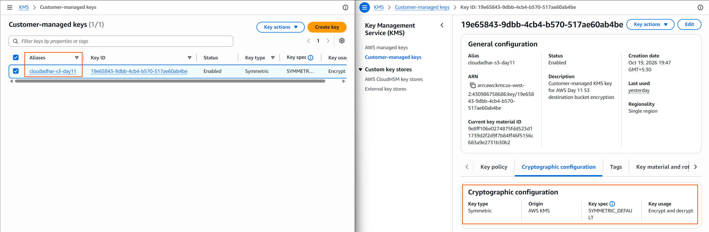

---

## 2. Private Source Bucket

Created the source bucket `cloudadhar-malathi-day11-source-2026-2021-new`.

Configured and verified:

- S3 Block Public Access with all four settings enabled
- Bucket owner enforced with ACLs disabled
- S3 Versioning
- Default SSE-S3 encryption

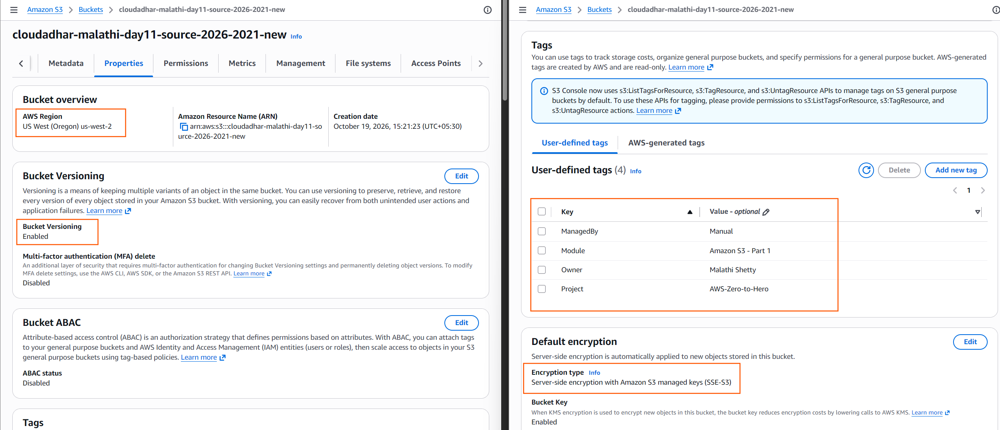

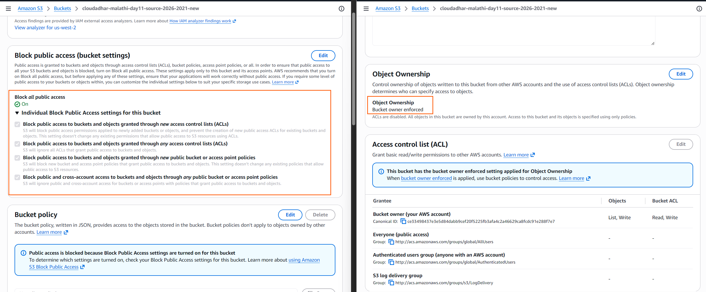

---

## 3. SSE-KMS Destination Bucket

Created the destination bucket `cloudadhar-s3-day11-copy-430986758686`.

Configured the bucket with:

- Block Public Access enabled
- Bucket owner enforced
- Versioning enabled
- Default SSE-KMS encryption
- S3 Bucket Key enabled

Used the customer-managed KMS key `alias/cloudadhar-s3-day11` for the destination encryption configuration.

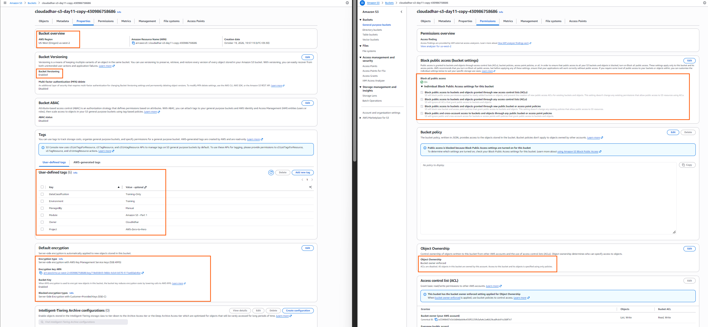

---

## 4. S3 Prefixes and Storage Classes

Created the demonstration prefixes and uploaded the required sample objects.

Verified the storage classes of the demonstration files:

- `standard-demo.txt` — S3 Standard
- `intelligent-tiering-demo.txt` — S3 Intelligent-Tiering

Additional objects were used for versioning, private-access, presigned URL, and lifecycle demonstrations.

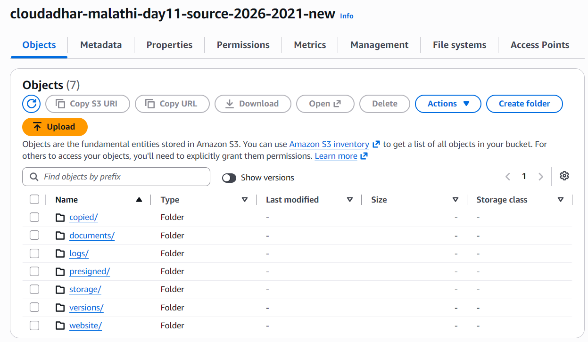

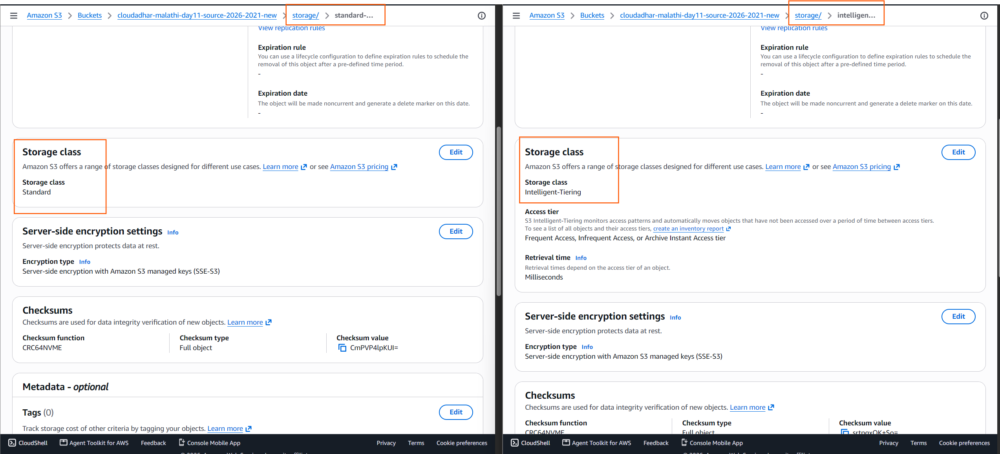

---

## 5. S3 Versioning — Version 1 and Version 2

Uploaded Version 1 and Version 2 of `version-demo.txt` under the same S3 key:

`versions/version-demo.txt`

Enabled **Show versions** and verified that the two data versions had different Version IDs.

Deleted the object normally to create a delete marker, then removed the delete marker to recover the previous data version.

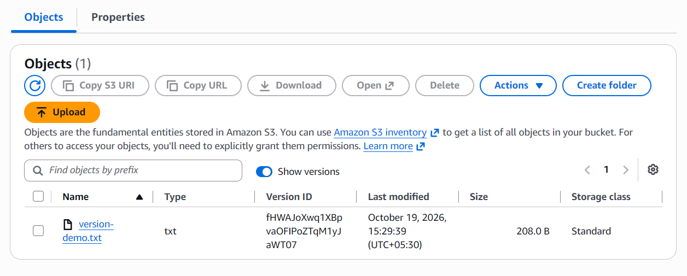

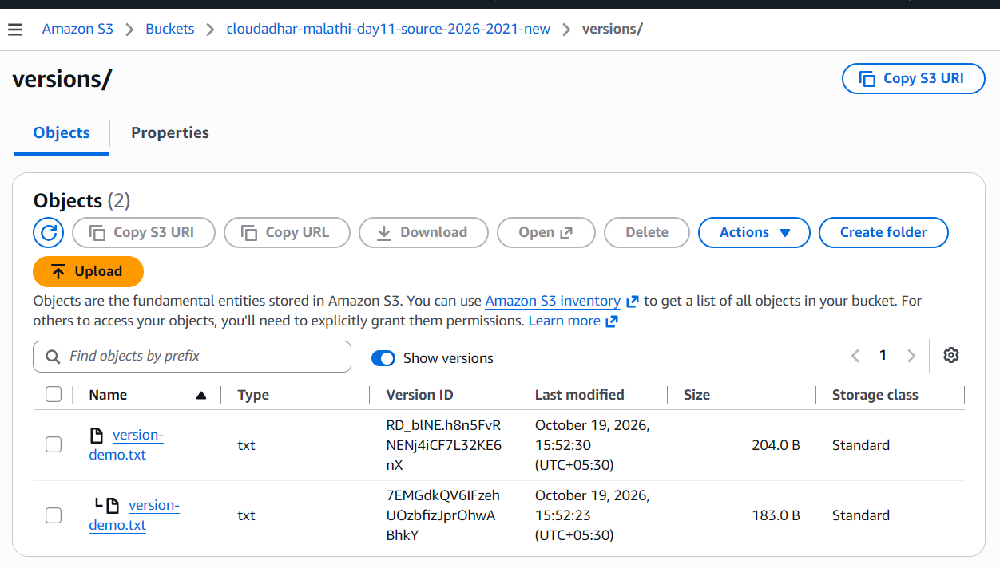

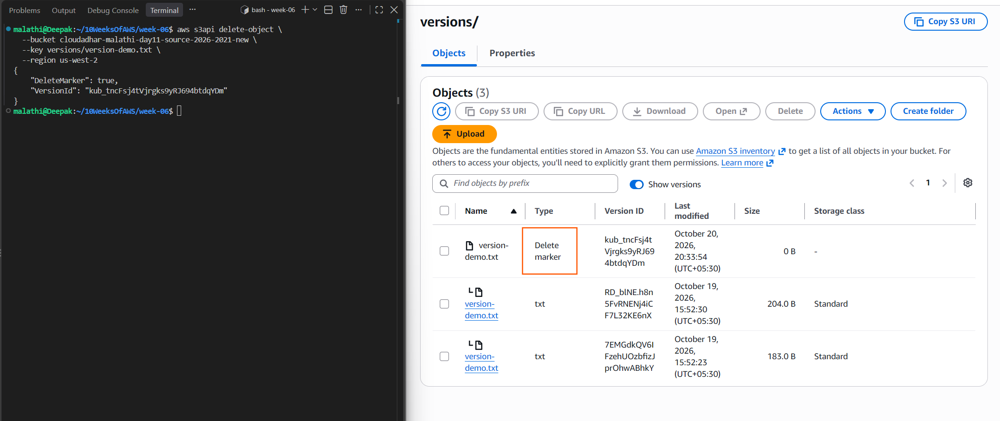

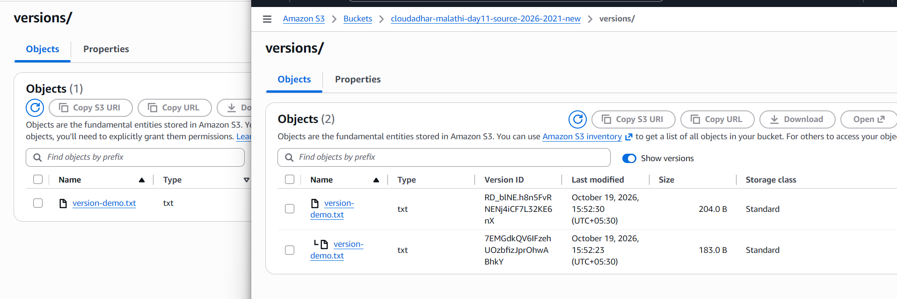

---

## 6. Bucket-to-Bucket Object Copy

Copied `documents/private-report.txt` from the source bucket to the destination bucket using the S3 copy operation.

The destination object key was:

`copied/private-report.txt`

Verified the copied object's metadata and confirmed that the destination copy used SSE-KMS encryption, with the customer-managed KMS key and S3 Bucket Key enabled.

The destination object has its own version identity, separate from the source object's version.

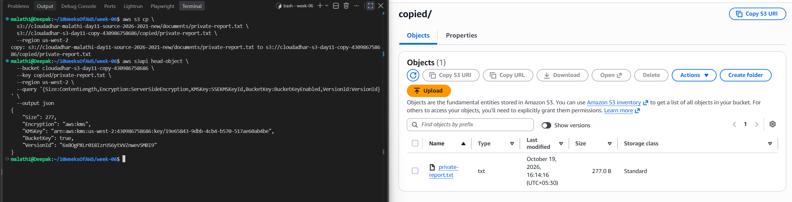

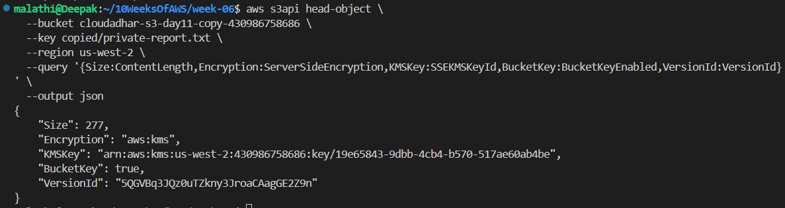

---

## 7. Private Object Access

Opened the normal S3 Object URL in a browser and verified that anonymous access was denied.

This confirmed that the object remained private while Block Public Access was enabled.

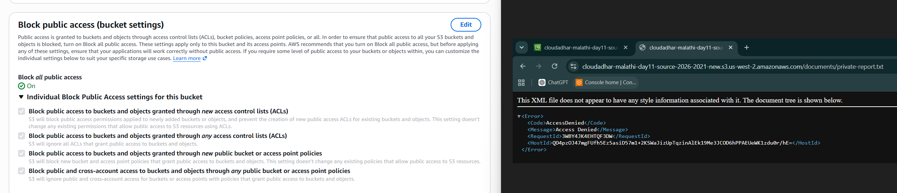

---

## 8. Block Public Access Policy Protection

Performed a controlled test using a bucket policy that attempted to grant public `s3:GetObject` access.

AWS rejected the policy with `AccessDenied` because public policies were prevented by the `BlockPublicPolicy` setting.

All four Block Public Access settings remained enabled. The public-read policy was not successfully applied.

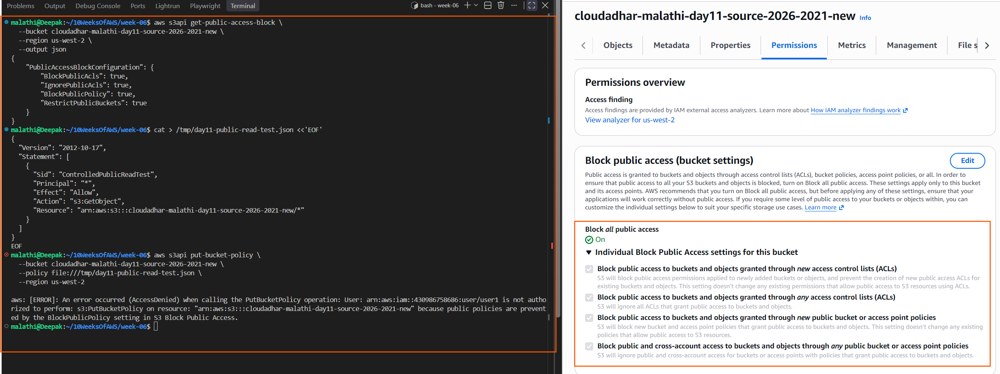

---

## 9. Presigned URL Validation

Generated a short-lived presigned URL for a private S3 object.

Verified that the presigned URL provided temporary access without making the bucket public. Also tested the URL after expiry and verified that expired access was rejected.

The normal object URL remained private.

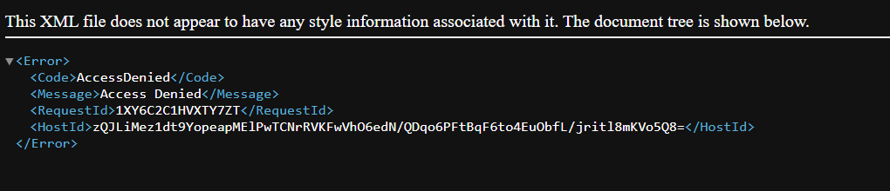

---

## 10. S3 Lifecycle Management

Created and verified a Lifecycle rule scoped to the `logs/` prefix.

Configured the following lifecycle actions:

- Transition current objects to S3 Standard-IA after 30 days
- Transition current objects to Glacier Flexible Retrieval after 90 days
- Expire current objects after 365 days
- Transition noncurrent versions after 30 days
- Expire noncurrent versions after 90 days
- Abort incomplete multipart uploads after 7 days

These are configured future lifecycle actions; the lab did not wait for the actual transitions or expiration periods to occur.

---

## 11. Object Lock Bucket

Created the dedicated Object Lock bucket:

`cloudadhar-s3-day11-lock-430986758686`

Verified that Object Lock was enabled. Default retention was disabled; Legal Hold was applied to the specific demonstration object version instead.

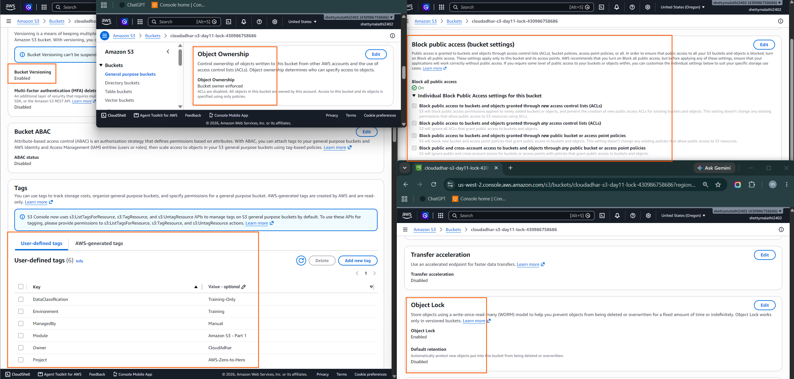

---

## 12. Legal Hold Enabled

Uploaded `retention-demo.txt` to the Object Lock bucket and enabled Legal Hold on the specific object version.

Verified that the Legal Hold status was `ON`.

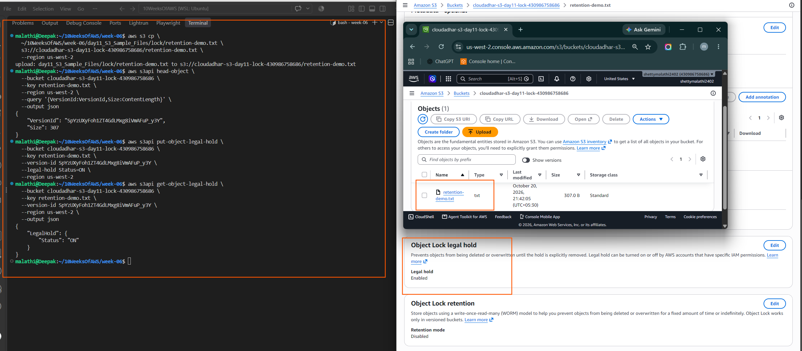

---

## 13. Legal Hold Prevents Deletion

Attempted to permanently delete the protected object version while Legal Hold was enabled.

AWS returned `AccessDenied`, confirming that the protected version could not be permanently deleted while the hold remained active.

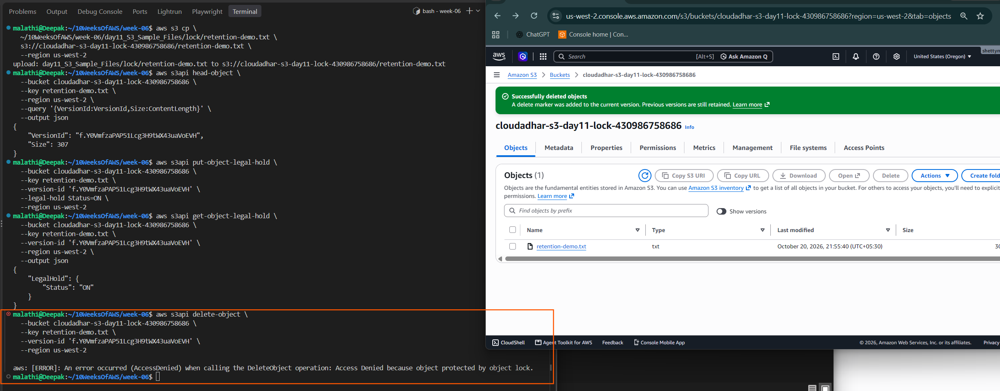

---

## 14. Legal Hold Removed and Object Deleted

Turned Legal Hold `OFF` on the exact object version, verified the status, and then permanently deleted that version.

Verified the version deletion and removed the remaining delete marker during cleanup.

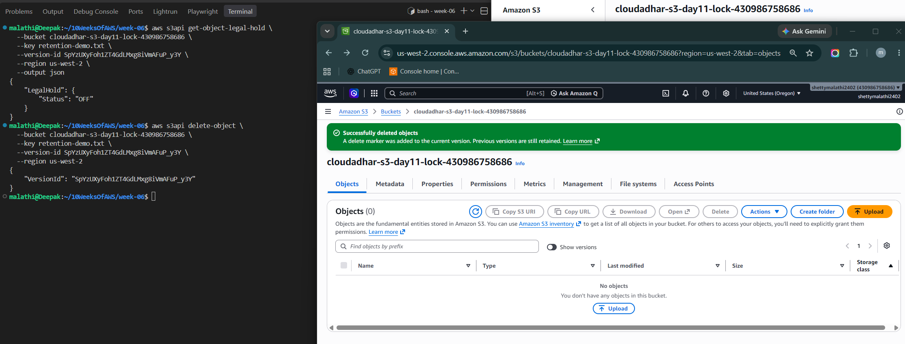

---

## Cleanup

The lab includes the following cleanup tasks. Mark each complete only after verifying it in AWS.

- [ ] Remove the Lifecycle rule.
- [ ] Remove all source-bucket object versions and delete markers.
- [ ] Remove all destination-bucket object versions and delete markers.
- [x] Permanently delete the protected demonstration version after removing Legal Hold.
- [ ] Verify the Object Lock bucket is empty, then delete it.
- [ ] Verify the destination bucket is empty, then delete it.
- [ ] Verify the source bucket is empty, then delete it.
- [ ] Review the KMS key and schedule deletion if it is no longer needed.
- [ ] Verify that no Day 11 S3 resources remain that could incur charges.

## LinkedIn Post

[Add your Day 11 LinkedIn post URL here]
