# Day 12 Lab - S3 Replication, Transfer, and Hybrid Storage

## Name

Malathi Shetty

## Tasks Completed

- [x] Watched/read the weekly content
- [x] Completed hands-on S3 replication labs
- [x] Added screenshots and proof
- [x] Configured Same-Region Replication (SRR)
- [x] Configured Cross-Region Replication (CRR)
- [x] Verified object version history
- [x] Tested prefix-based replication filtering
- [x] Completed a real multipart upload
- [x] Configured incomplete multipart-upload cleanup
- [x] Tested S3 Object Lock Compliance retention
- [x] Configured an S3 static website
- [ ] Verified Transfer Acceleration successfully enabled
- [ ] Confirmed final AWS resource cleanup

## Architecture

Day 12 demonstrates Amazon S3 replication, object versioning, prefix filtering, multipart uploads, Object Lock, and static website hosting.

**Source region:** Oregon (`us-west-2`)

**SRR destination:** Oregon (`us-west-2`)

**CRR destination:** Tokyo (`ap-northeast-1`)

The static website and Object Lock demonstrations use separate buckets to keep these experiments isolated from the replication buckets.

## Result

Successfully completed the main Day 12 Amazon S3 hands-on exercises, including Same-Region Replication, Cross-Region Replication, version history, prefix-based filtering, multipart upload, lifecycle configuration, Object Lock Compliance retention, and static website hosting.

### Resources Created

| Resource | Name | Region |
|---|---|---|
| Source bucket | `cloudadhar-malathi-day12-source-2026-2021` | Oregon |
| SRR destination | `cloudadhar-malathi-day12-srr-dest-2026-2021` | Oregon |
| CRR destination | `cloudadhar-malathi-day12-crr-dest-2026-2021` | Tokyo |
| Object Lock test bucket | `cloudadhar-malathi-day12-object-lock-2026-2021` | Oregon |
| Static website bucket | `cloudadhar-malathi-day12-website-2026-2021` | Oregon |
| SRR rule | `day12-srr-rule` | Oregon |
| CRR rule | `day12-crr-rule` | Oregon |
| Multipart cleanup rule | `day12-abort-incomplete-multipart` | Source bucket |

## 1. Three S3 Replication Buckets

Created the source, SRR destination, and CRR destination buckets.

Configured versioning and SSE-S3 encryption. Public access blocking was enabled on the replication buckets.

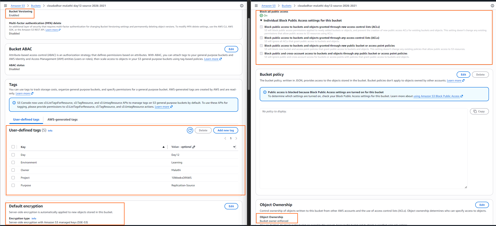

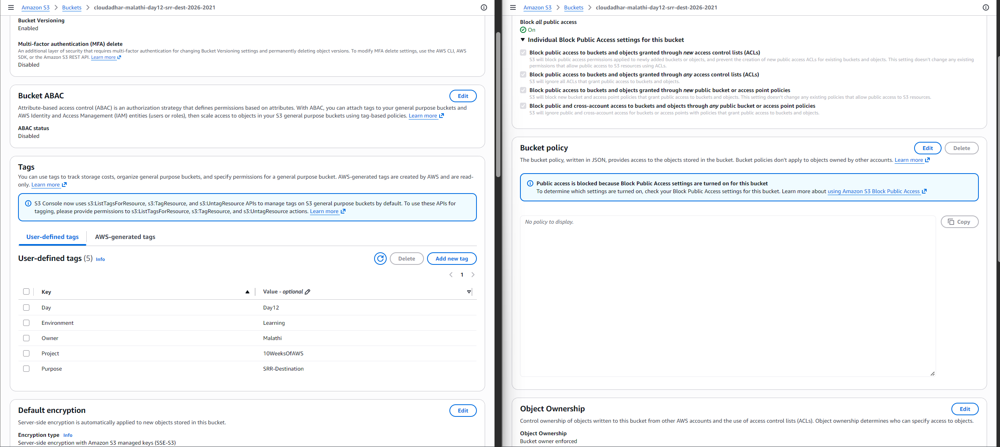

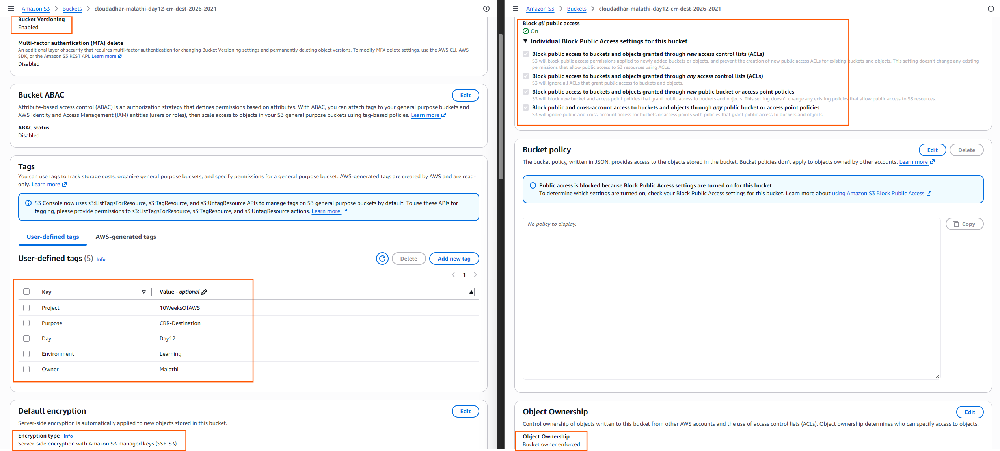

---

## 2. Bucket Regions

Configured the source and SRR destination in Oregon (`us-west-2`) and the CRR destination in Tokyo (`ap-northeast-1`).

Oregon was selected for the source and SRR buckets to align with the lab's cost-conscious regional setup. Tokyo was retained for the cross-region replication demonstration.

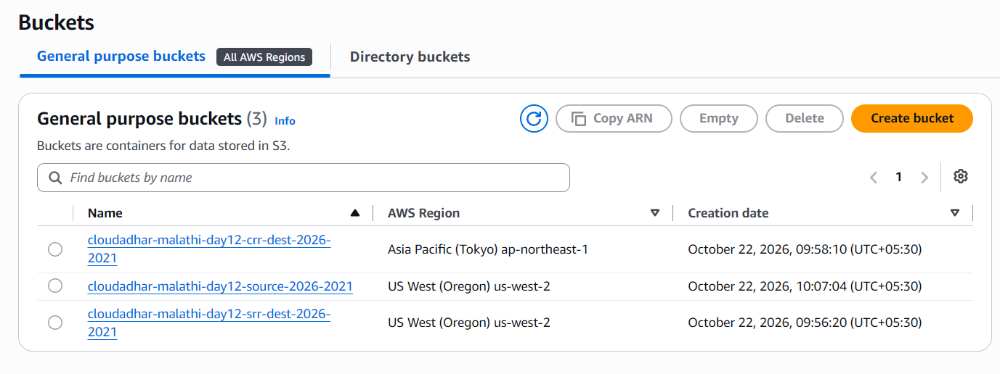

---

## 3. Objects Uploaded Before Replication Rules

Uploaded the following objects before creating the replication rules:

- `srr/before-rule.txt`
- `crr/before-rule.txt`

These objects demonstrate that enabling a replication rule does not automatically replicate previously uploaded objects unless existing-object replication is separately configured.

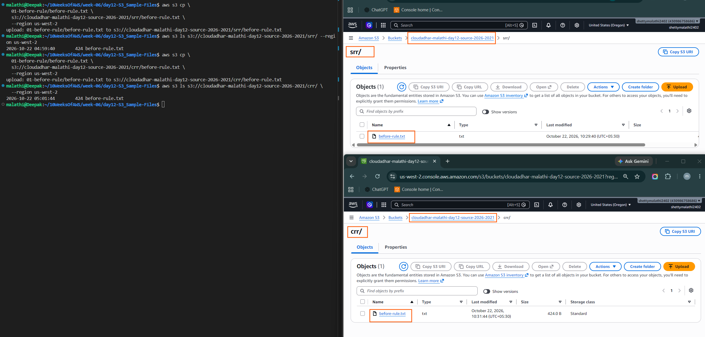

---

## 4. Same-Region Replication (SRR)

Created the SRR rule with the following configuration:

- Rule name: `day12-srr-rule`
- Status: Enabled
- Prefix filter: `srr/`
- Destination: `cloudadhar-malathi-day12-srr-dest-2026-2021`
- Destination region: Oregon (`us-west-2`)
- IAM replication role: `s3crr_role_for_cloudadhar-malathi-day12-source-2026-2021`

Uploaded the SRR demonstration object after the rule was enabled and verified that replication completed.

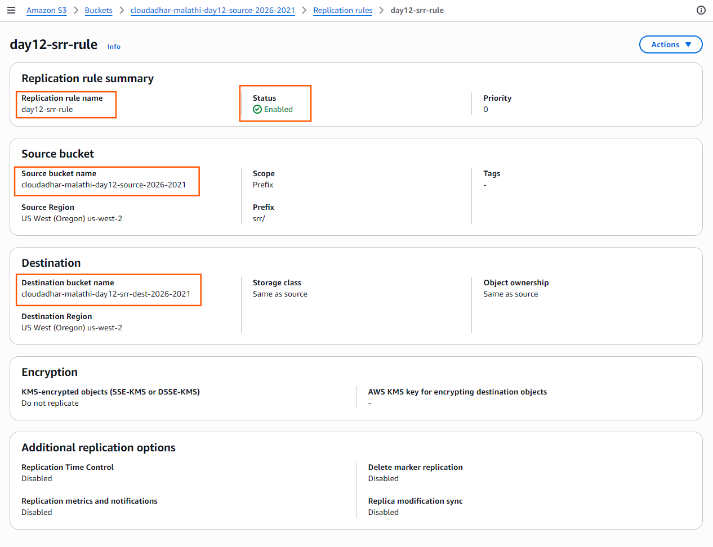

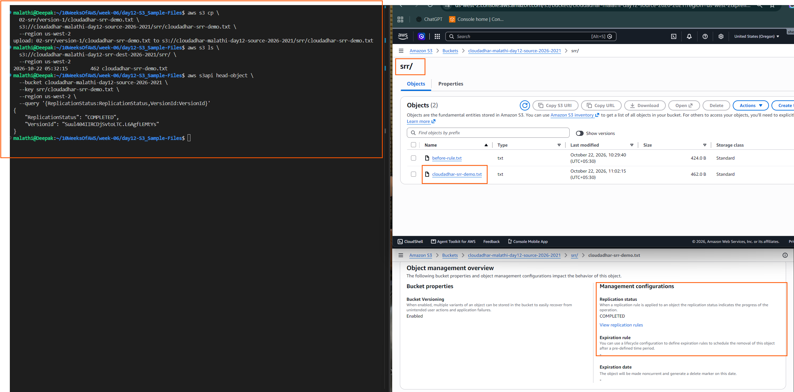

### SRR Version History

Uploaded multiple versions using the same object key:

`srr/cloudadhar-srr-demo.txt`

Verified that Version 1 and Version 2 were present in the SRR destination bucket.

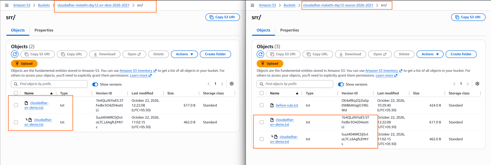

---

## 5. Cross-Region Replication (CRR)

Created the CRR rule with the following configuration:

- Rule name: `day12-crr-rule`
- Status: Enabled
- Prefix filter: `crr/`
- Destination: `cloudadhar-malathi-day12-crr-dest-2026-2021`
- Destination region: Tokyo (`ap-northeast-1`)
- IAM replication role: `s3crr_role_for_cloudadhar-malathi-day12-source-2026-2021`

During troubleshooting, the replication role's destination permissions were updated to include both destination buckets.

The CRR test subsequently returned `ReplicationStatus: COMPLETED`.

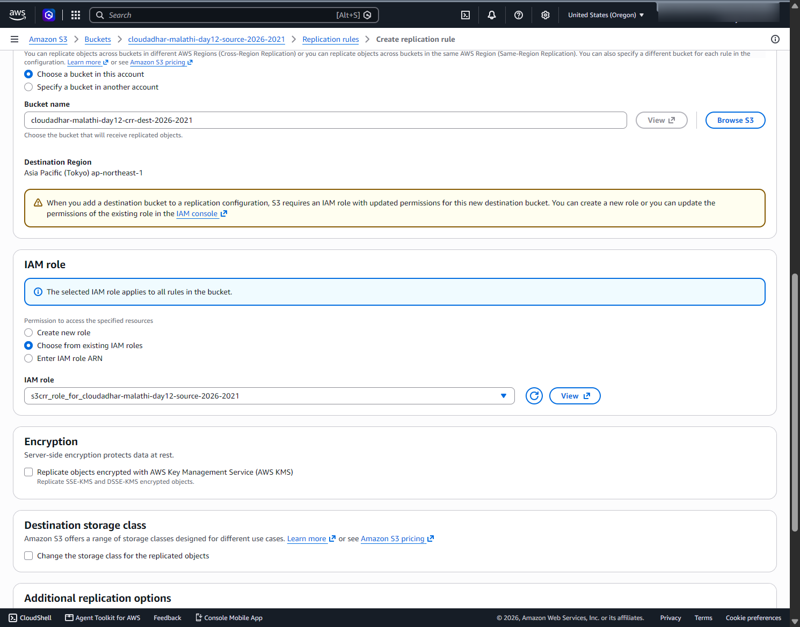

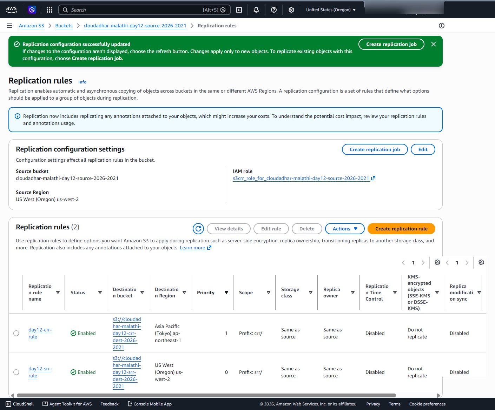

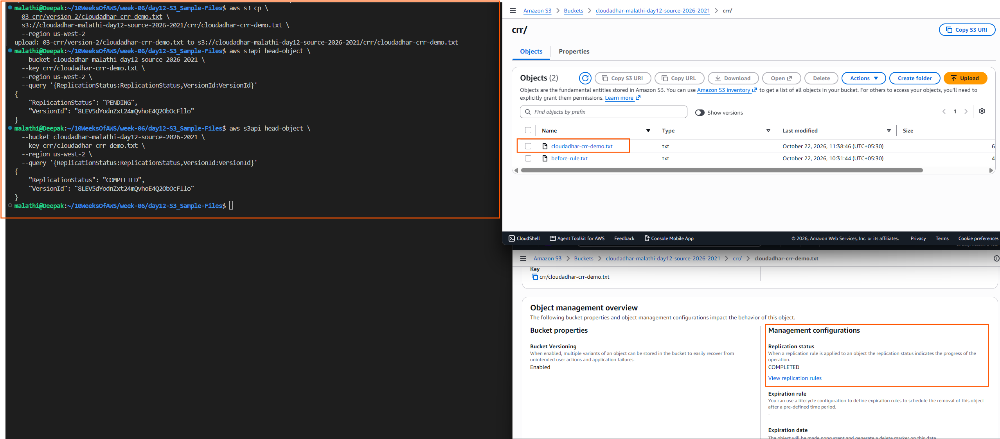

### CRR Version History

Uploaded multiple versions using the same object key:

`crr/cloudadhar-crr-demo.txt`

Verified that two versions appeared in the Tokyo destination bucket.

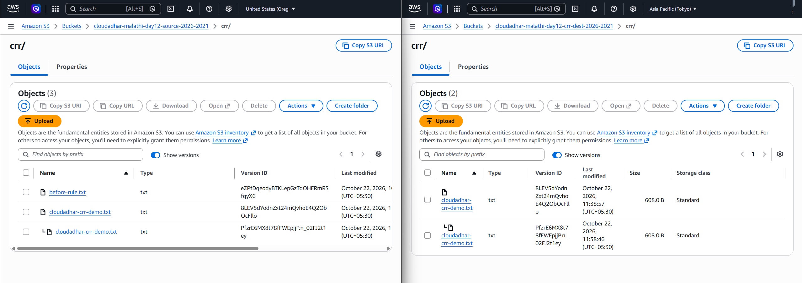

---

## 6. Prefix Filtering Validation

Created an unmatched object under the `other/` prefix:

`other/no-replication-demo.txt`

Verified that the object remained in the source bucket and did not appear in either the SRR or CRR destination.

This demonstrated how prefix filters control which objects are eligible for replication.

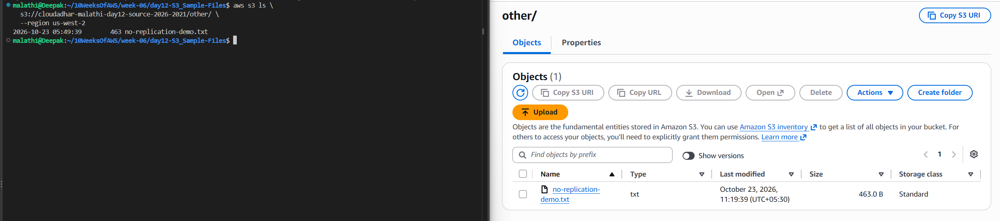

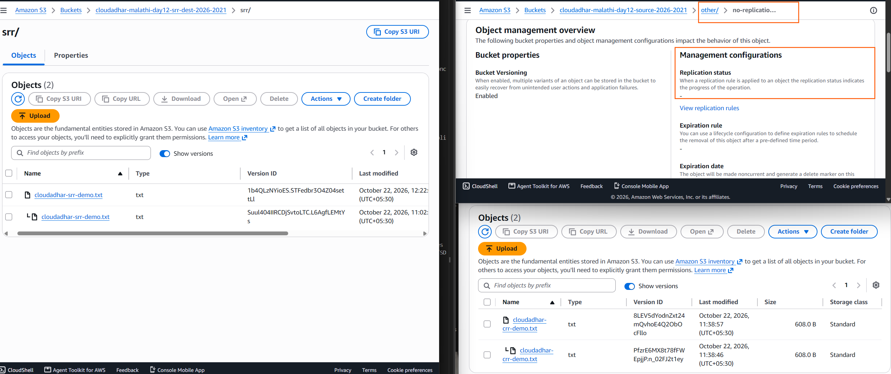

---

## 7. S3 Transfer Acceleration

Reviewed the Transfer Acceleration configuration for the source bucket.

The attempt to enable Transfer Acceleration was blocked by AWS with `AccessDenied` for `s3:PutAccelerateConfiguration`. The feature therefore remains unverified as enabled.

This was documented as an IAM permission troubleshooting issue rather than a successful configuration.

---

## 8. Multipart Upload

Created a 6 MiB demonstration file and uploaded it using the explicit S3 multipart upload API.

The file was uploaded in two parts:

- Part 1: 5 MiB
- Part 2: 1 MiB

Completed the multipart upload and verified the resulting object size of 6,291,456 bytes using `head-object`.

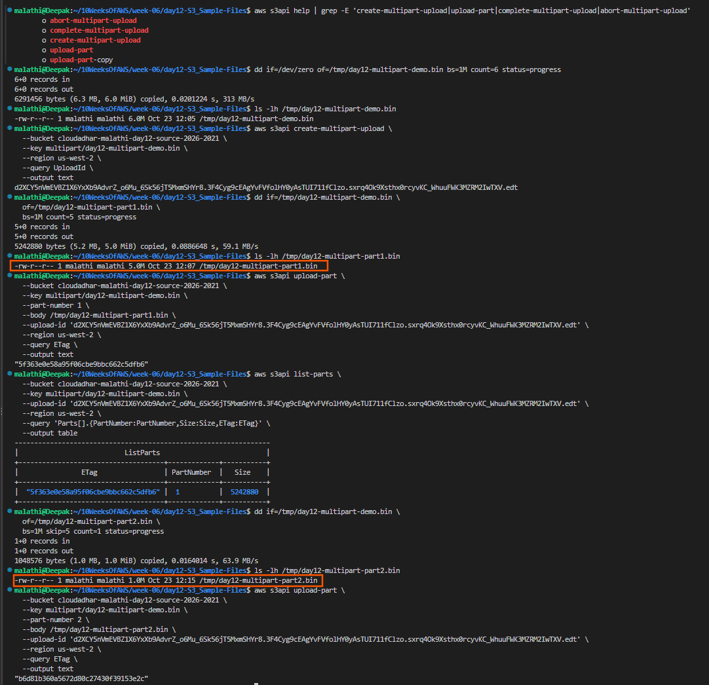

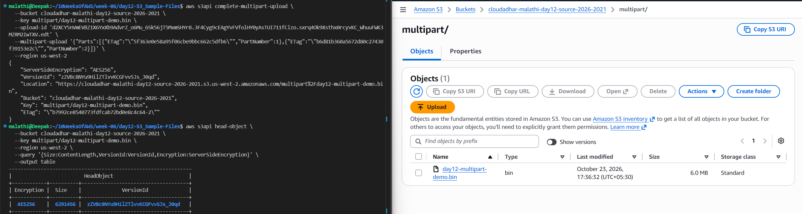

---

## 9. Incomplete Multipart Upload Cleanup

Configured a lifecycle rule on the source bucket:

- Rule name: `day12-abort-incomplete-multipart`
- Scope: All objects
- Action: Abort incomplete multipart uploads
- Age: 7 days

This rule is intended to remove incomplete multipart uploads after the configured period. It does not delete successfully completed objects.

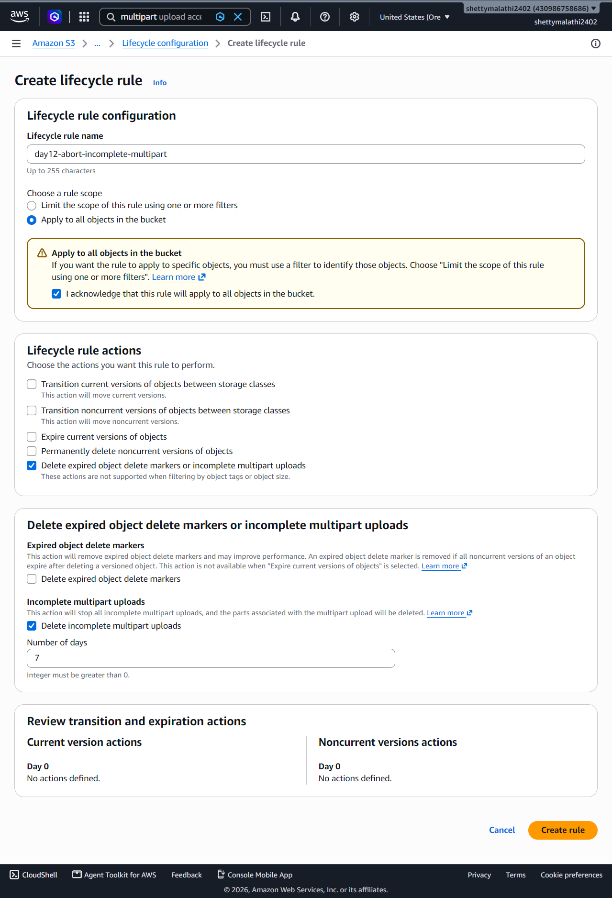

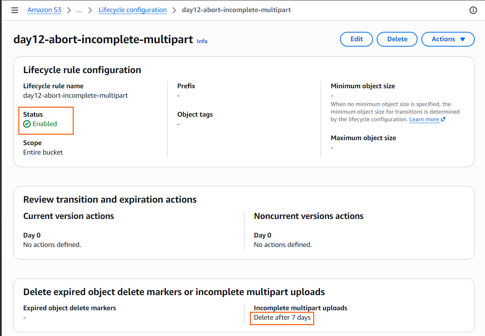

---

## 10. S3 Object Lock Compliance

Created a separate test bucket:

`cloudadhar-malathi-day12-object-lock-2026-2021`

Enabled Object Lock and versioning, uploaded `retention-demo.txt`, and configured a short Compliance retention period.

Verified that the object version had `Mode: COMPLIANCE` and a retention expiry date.

A version-specific deletion attempt returned `AccessDenied` because the object was protected by Object Lock.

A normal delete can create a delete marker without removing the protected data version. The protected version remains retained until its Compliance period expires.

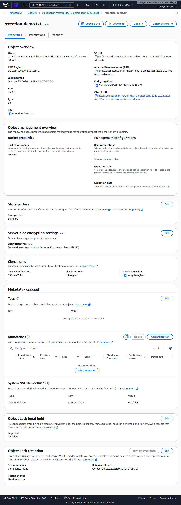

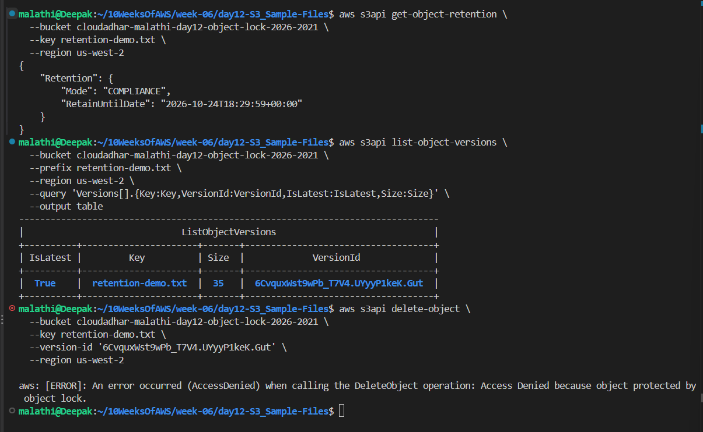

---

## 11. S3 Static Website Hosting

Created a dedicated website bucket:

`cloudadhar-malathi-day12-website-2026-2021`

Configured native S3 static website hosting with:

- Index document: `index.html`
- Error document: `error.html`
- Region: Oregon (`us-west-2`)

Created a custom HTML homepage and uploaded it to the website bucket.

The website bucket's public-access configuration and bucket policy were handled separately from the private replication buckets. Public access is not required for private S3 object storage, but anonymous browser access to a native S3 website requires appropriate public-read permissions.

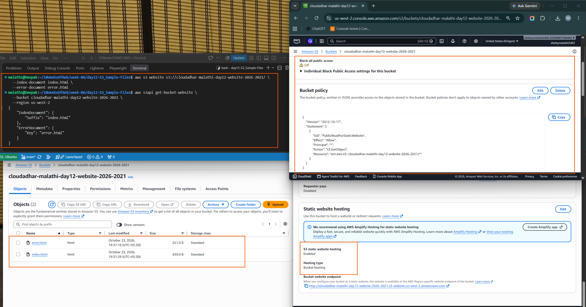

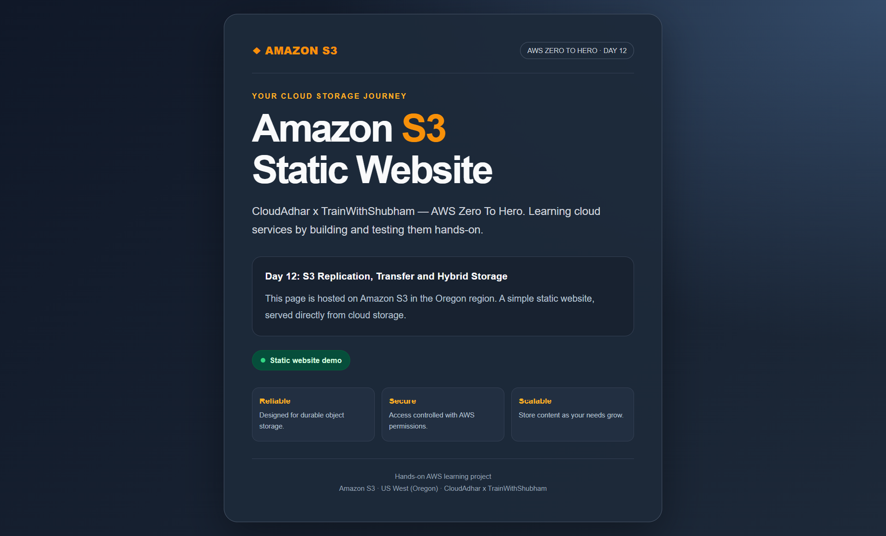

---

## 12. Amazon FSx and Hybrid Storage Review

Reviewed the available Amazon FSx options and their use cases.

- **FSx for Windows File Server:** Managed Windows file shares using SMB.
- **FSx for Lustre:** High-performance file storage for compute-intensive workloads.
- **FSx for NetApp ONTAP:** Enterprise file storage with NetApp compatibility.
- **FSx for OpenZFS:** Managed ZFS-based file storage.

Also reviewed AWS hybrid storage services:

- **S3 File Gateway:** File-based access to S3 using NFS or SMB.
- **Volume Gateway:** Cloud-backed block storage.
- **Tape Gateway:** Virtual tape backups.
- **AWS DataSync:** Automated data transfer between storage systems.
- **AWS Snow Family:** Offline data transfer and edge-computing use cases.
- **AWS Transfer Family:** Managed file transfers using supported protocols.

These services were reviewed without deploying additional paid resources.

---

## Cleanup and Cost Control

The lab used separate buckets for replication, Object Lock, and website testing to isolate configurations.

Before considering the lab fully cleaned up:

1. Remove the replication rules and lifecycle rule when no longer required.
2. Empty the source and destination buckets, including all object versions and delete markers.
3. Remove the test website's public bucket policy if one was successfully applied.
4. Restore Block Public Access on the website bucket.
5. Disable website hosting and delete the website bucket when it is no longer needed.
6. Wait for the Object Lock Compliance retention period to expire before deleting the protected version.
7. Delete the Object Lock test bucket after all retained versions are eligible for removal.
8. Verify that no unwanted buckets or configurations remain.

**Note:** Transfer Acceleration was not successfully enabled due to an AWS permission error. Final cleanup should be verified before marking all resources as deleted.

---

## LinkedIn Post

Add your Day 12 LinkedIn post URL here after publishing.
